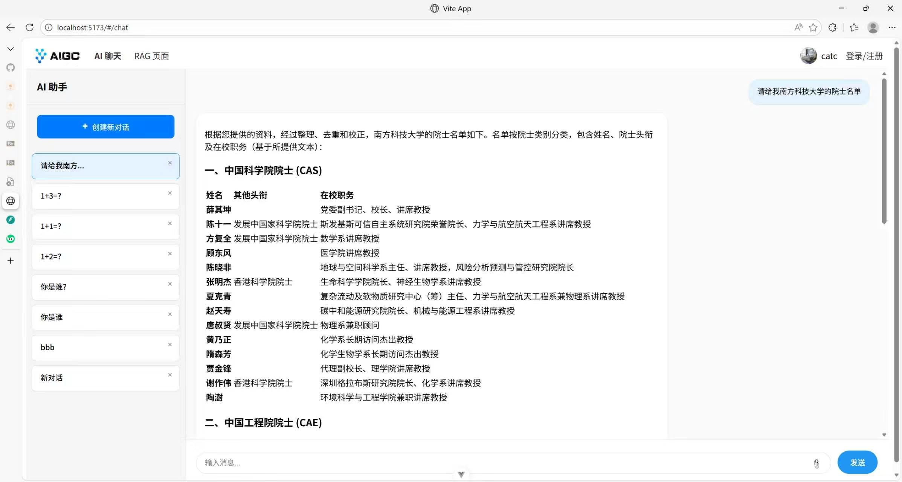

# Student Productivity Agent - 学生效率助手

一款基于 AI 的学生效率提升工具，整合日程管理、智能规划和文档问答功能。

---

## 🚀 功能特性

### 1. AI 智能聊天
- 与 AI 助手进行自然语言对话
- 支持复杂问题解答
- 提供个性化学习建议

### 2. RAG 文档问答
- 上传文档并进行智能问答
- 支持多种文档格式
- 基于检索增强生成的精准回答

### 3. 日程管理
- 周视图日历展示
- 课程表与任务融合
- AI 智能规划建议

### 4. 待办事项
- 任务创建与管理
- 状态追踪
- 优先级排序

### 5. 用户管理
- 用户注册与登录
- 个人信息管理
- 头像上传

---

## 📷 使用截图



---

## 🛠️ 技术栈

### 前端
- **框架**: Vue 3 + Vite
- **状态管理**: Pinia
- **路由**: Vue Router
- **UI 组件**: Element Plus
- **富文本编辑器**: Quill

### 后端
- **框架**: FastAPI
- **数据库**: MySQL + SQLAlchemy
- **缓存**: Redis
- **认证**: JWT
- **对象存储**: 阿里云 OSS
- **AI 服务**: 百炼大模型

---

## 📦 安装与运行

### 前端部署

```bash
# 进入前端目录
cd vue

# 安装依赖
npm install

# 开发模式运行
npm run dev

# 生产构建
npm run build
```

### 后端部署

#### 1. 配置环境变量

以管理员身份打开 cmd 终端，配置阿里云密钥：

```cmd
set OSS_ACCESS_KEY_ID=your_access_key
set OSS_ACCESS_KEY_SECRET=your_secret_key
setx OSS_ACCESS_KEY_ID "%OSS_ACCESS_KEY_ID%"
setx OSS_ACCESS_KEY_SECRET "%OSS_ACCESS_KEY_SECRET%"
```

配置百炼大模型密钥（在"高级系统设置"的"环境变量"中添加）。

#### 2. 使用 Conda 创建环境

```bash
# 进入后端目录
cd python_demo

# 创建环境
conda env create -f environment.yml

# 激活环境
conda activate fastApi_env

# 运行项目
uvicorn main:app --reload
```

#### 3. 后续运行

```bash
conda activate fastApi_env
uvicorn main:app --reload
```

---

## 🔧 一键部署（推荐）

使用 GitHub Actions 生成的产物进行快速部署：

### 步骤 1: 下载部署文件

1. 访问 GitHub 仓库的 Actions 页面
2. 选择任意成功运行的 workflow
3. 在 **Artifacts** 区域下载以下文件：
   - `frontend-dist.zip` - 前端构建产物
   - `backend-runtime.zip` - 后端运行时文件

### 步骤 2: 准备部署目录

创建一个新目录，放入以下文件：

```
deploy/
├── deploy_backend.py    # 从项目根目录复制
├── deploy_frontend.py   # 从项目根目录复制
├── frontend-dist.zip    # 从 GitHub Actions 下载
└── backend-runtime.zip  # 从 GitHub Actions 下载
```

### 步骤 3: 设置环境变量

在终端中设置必要的环境变量（Windows）：

```cmd
set OSS_ACCESS_KEY_ID=your_access_key
set OSS_ACCESS_KEY_SECRET=your_secret_key
set DASHSCOPE_API_KEY=your_dashscope_key
```

### 步骤 4: 启动服务

**终端 1 - 启动前端：**
```bash
python deploy_frontend.py
```
然后选择选项 1 启动前端服务器

**终端 2 - 启动后端：**
```bash
python deploy_backend.py
```
按照提示完成依赖安装，然后手动启动服务

### 步骤 5: 访问应用

- **前端**: http://localhost:8080
- **后端 API**: http://localhost:8000
- **API 文档**: http://localhost:8000/docs

---

## 🌐 访问地址

- **前端**: http://localhost:5173（开发模式）/ http://localhost:8080（部署模式）
- **后端 API**: http://localhost:8000
- **API 文档**: http://localhost:8000/docs

---

## 📁 项目结构

```
team-project-26spring-26s-18/
├── python_demo/          # 后端项目
│   ├── main.py           # FastAPI 入口
│   ├── config/           # 配置文件
│   ├── crud/             # 数据操作层
│   ├── models/           # 数据模型
│   ├── routers/          # API 路由
│   ├── schemas/          # 数据结构定义
│   └── utils/            # 工具函数
├── vue/                  # 前端项目
│   ├── src/
│   │   ├── views/        # 页面组件
│   │   ├── components/   # 子组件
│   │   ├── api/          # API 请求封装
│   │   ├── stores/       # 状态管理
│   │   └── router/       # 路由配置
│   └── package.json
├── figures/              # 文档图片
├── design-26s-18.md      # 架构设计文档
├── Sprint 2.md           # Sprint 2 要求文档
└── README.md             # 项目说明文档
```

---

## 📖 架构设计

项目采用前后端分离架构：

- **前端层**: Vue 3 + Element Plus，提供用户交互界面
- **后端层**: FastAPI + MySQL + Redis，提供 API 服务
- **数据层**: MySQL 存储持久化数据，Redis 缓存临时数据

详细架构设计请参考 [design-26s-18.md](文档/design-26s-18.md)

---

## ⚠️ 已知问题

1. 需要配置阿里云 OSS 和百炼大模型密钥才能完整运行
2. 后端依赖 MySQL 数据库连接（配置在 config/db_config.py）
3. 建议使用 Conda 环境以避免依赖冲突

---

## 📚 相关文档

- [架构设计文档](文档/design-26s-18.md)
- [后端部署指南](python_demo/Readme.md)
- [前端部署指南](vue/README.md)

---

## 📝 License

MIT License
