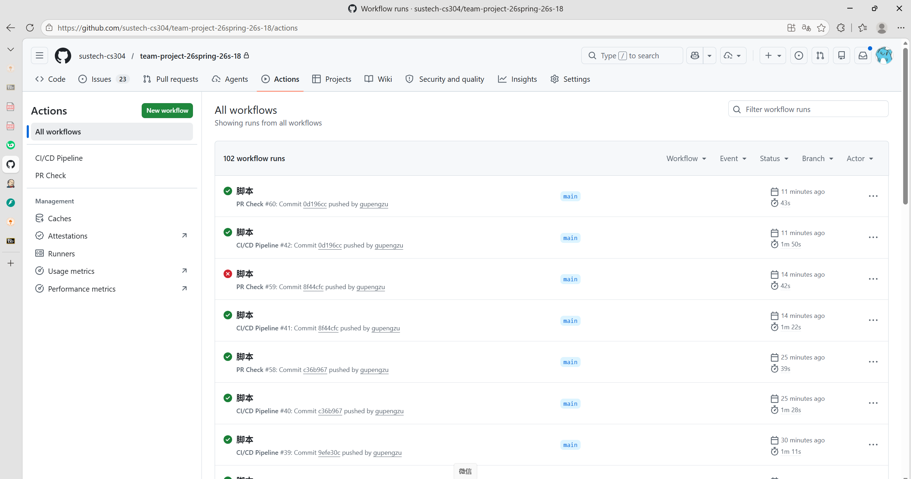

# 团队报告

## Part II. 团队报告 (4 分)

### 1. 指标 (2 分)

| 指标        | 值                |
| --------- | ---------------- |
| **代码行数**  | 28,118           |
| **源文件数量** | 85               |
| **圈复杂度**  | 2870 (平均: 55.19) |
| **依赖项数量** | 43               |

**详细说明：**

- Python 文件: 56 个（其中 52 个可分析，4个为空文件或者废弃的文件）
- JavaScript 文件: 14 个
- Vue 文件: 15 个
- Python 依赖: 21 个
- npm 运行时依赖: 12 个
- npm 开发依赖: 10 个

**计算方法：**

1. **代码行数**：统计所有 Python、JavaScript 和 Vue 源文件的行数（排除废弃代码目录）
2. **源文件数量**：统计项目中所有源代码文件（排除 `scripts废案`、`file_helper已弃用` 等目录）
3. **圈复杂度**：使用 `radon` 库分析 52 个 Python 文件，计算每个函数/方法的圈复杂度并求和
4. **依赖项数量**：统计 `requirements.txt` 中的 Python 依赖和 `package.json` 中的 npm 依赖

***

### 2. CI/CD 流水线描述 (2 分)

#### 2.1 概述

项目采用基于 GitHub Actions 的两阶段 CI/CD 流水线，包括：

- **PR 检查工作流**：用于拉取请求的自动化质量检查
- **CI/CD 流水线工作流**：完整的构建、测试和产物部署

#### 2.2 流水线步骤

##### PR 检查工作流 (`pr-check.yml`)

| 阶段        | 步骤         | 描述                                                              |
| --------- | ---------- | --------------------------------------------------------------- |
| **后端 CI** | 检出代码       | 克隆仓库                                                            |
| <br />    | 配置 Python  | 配置 Python 3.11 环境                                               |
| <br />    | 安装依赖       | 通过 `requirements.txt` 安装依赖                                      |
| <br />    | 运行测试       | 执行 `pytest` 测试套件                                                |
| **前端 CI** | 检出代码       | 克隆仓库                                                            |
| <br />    | 配置 Node.js | 配置 Node.js 20.x 环境                                              |
| <br />    | 安装依赖       | 运行 `npm install`                                                |
| <br />    | 运行测试       | 执行 `vitest run` 测试套件                                            |
| <br />    | 构建         | 使用 `npm run build` 编译前端                                         |
| **后端打包**  | 打包产物       | 创建包含 `python_demo` 和 `file_helper` 目录的 `backend-runtime.tar.gz` |
| **上传产物**  | 上传后端       | 上传后端产物到工作流                                                      |
| <br />    | 上传前端       | 上传前端产物到工作流                                                      |

##### CI/CD 流水线工作流 (`ci-cd.yml`)

| 阶段       | 步骤         | 描述                 |
| -------- | ---------- | ------------------ |
| **后端构建** | 检出代码       | 克隆仓库               |
| <br />   | 配置 Python  | 配置 Python 3.11 环境  |
| <br />   | 安装依赖       | 安装项目依赖             |
| <br />   | 运行测试       | 执行 pytest 测试套件     |
| <br />   | 打包         | 创建后端运行时归档          |
| **前端构建** | 检出代码       | 克隆仓库               |
| <br />   | 配置 Node.js | 配置 Node.js 20.x 环境 |
| <br />   | 安装依赖       | 运行 `npm install`   |
| <br />   | 运行测试       | 执行 Vitest 测试套件     |
| <br />   | 构建         | 编译并压缩前端资源          |
| **部署**   | 上传到 OSS    | 部署产物到阿里云 OSS       |

#### 2.3 工具和技术

| 步骤           | 工具                    | 版本       |
| ------------ | --------------------- | -------- |
| **版本控制**     | Git + GitHub          | -        |
| **CI/CD 编排** | GitHub Actions        | -        |
| **后端语言**     | Python                | 3.11.x   |
| **后端框架**     | FastAPI               | ^0.100.0 |
| **后端测试**     | pytest                | ^7.4.0   |
| **前端语言**     | JavaScript/TypeScript | ES6+     |
| **前端框架**     | Vue.js                | 3.x      |
| **前端测试**     | Vitest                | ^4.1.6   |
| **前端测试工具**   | @vue/test-utils       | ^2.4.6   |
| **DOM 环境**   | happy-dom             | ^14.12.0 |
| **构建工具**     | Vite                  | ^5.4.14  |
| **依赖管理**     | npm, pip, conda       | 最新版本     |
| **云存储**      | 阿里云 OSS               | -        |

#### 2.4 流水线配置文件

| 文件        | 路径                                                                 | 描述                |
| --------- | ------------------------------------------------------------------ | ----------------- |
| PR 检查工作流  | [`.github/workflows/pr-check.yml`](.github/workflows/pr-check.yml) | 定义 PR 验证流水线       |
| CI/CD 流水线 | [`.github/workflows/ci-cd.yml`](.github/workflows/ci-cd.yml)       | 定义构建和部署流水线        |
| 前端配置      | [`vue/vite.config.js`](vue/vite.config.js)                         | Vite 配置，集成 Vitest |
| 前端依赖      | [`vue/package.json`](vue/package.json)                             | 前端依赖和脚本           |
| 后端依赖      | [`python_demo/requirements.txt`](python_demo/requirements.txt)     | Python 包依赖        |
| Conda 环境  | [`python_demo/environment.yml`](python_demo/environment.yml)       | Conda 环境配置        |

#### 2.5 部署脚本

项目包含用于本地测试的自动化部署脚本：

| 脚本   | 路径                                         | 描述                           |
| ---- | ------------------------------------------ | ---------------------------- |
| 后端部署 | [`deploy_backend.py`](deploy_backend.py)   | 解压后端产物，安装依赖（支持 conda），提供启动说明 |
| 前端部署 | [`deploy_frontend.py`](deploy_frontend.py) | 解压前端产物，设置本地静态文件服务器           |

#### 2.6 流水线执行证明

CI/CD 流水线已多次成功执行。以下是成功运行的截图：



**关键成功指标：**

- **PR 检查通过率**：100%（最近运行）
- **测试覆盖率**：后端：8 通过；前端：所有测试通过
- **构建成功**：前端和后端构建均成功完成
- **产物上传**：产物成功上传到 OSS 和工作流产物

#### 2.7 生成的产物

| 产物                       | 描述                                       |
| ------------------------ | ---------------------------------------- |
| `backend-runtime.tar.gz` | 包含 `python_demo` 和 `file_helper` 目录的压缩归档 |
| `frontend-dist.zip`      | 包含编译后前端资源的压缩归档（dist 目录）                  |

***

## 附录

### 流水线环境变量

流水线执行需要以下环境变量：

| 变量                      | 描述                             |
| ----------------------- | ------------------------------ |
| `OSS_ACCESS_KEY_ID`     | 阿里云 OSS 访问密钥                   |
| `OSS_ACCESS_KEY_SECRET` | 阿里云 OSS 密钥                     |
| `OSS_ENDPOINT`          | OSS 区域端点                       |
| `OSS_BUCKET_NAME`       | 目标 OSS Bucket 名称               |
| `DASHSCOPE_API_KEY`     | 阿里云 DashScope API 密钥（用于 AI 功能） |

### 本地部署说明

**后端：**

```bash
python deploy_backend.py
# 按照屏幕说明激活环境并启动服务器
```

**前端：**

```bash
python deploy_frontend.py
# 打开浏览器访问 http://localhost:8080
```

***

*报告生成日期：2026年5月*
