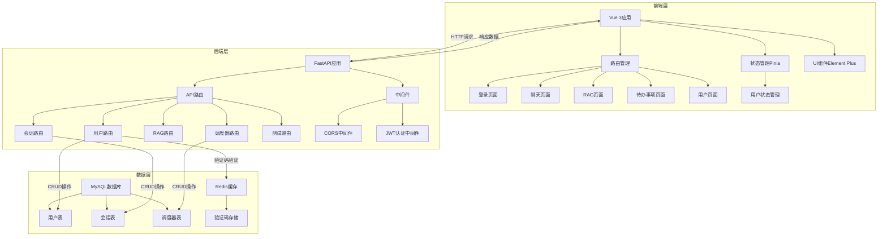

# 项目架构设计文档

## 1. 架构设计

### 1.1 架构概览

本项目采用前后端分离架构，前端使用Vue 3框架，后端使用FastAPI框架，通过RESTful API进行通信。项目整体分为前端应用层、后端服务层和数据存储层三个主要部分。

### 1.2 架构图表

### 1.3 组件说明

#### 1.3.1 前端层

| 组件 | 作用 | 说明 |
|------|------|------|
| Vue 3应用 | 前端应用入口 | 使用Vue 3框架构建，包含多个页面组件 |
| 路由管理 | 页面导航 | 使用Vue Router管理页面路由，包括登录、聊天、RAG、待办事项和用户页面 |
| 状态管理 | 数据状态管理 | 使用Pinia进行状态管理，主要管理用户登录状态 |
| UI组件 | 界面展示 | 使用Element Plus提供UI组件，提升用户体验 |
| 登录页面 | 用户认证 | 提供用户登录和注册功能 |
| 聊天页面 | 聊天功能 | 提供用户聊天交互功能 |
| RAG页面 | 检索增强生成 | 提供基于文档的问答功能 |
| 待办事项页面 | 任务管理 | 提供任务创建、管理和查看功能 |
| 用户页面 | 用户信息管理 | 提供用户个人信息编辑功能 |

#### 1.3.2 后端层

| 组件 | 作用 | 说明 |
|------|------|------|
| FastAPI应用 | 后端应用入口 | 使用FastAPI框架构建，提供RESTful API |
| API路由 | 请求处理 | 包含用户、会话、RAG、调度器和测试等路由 |
| 用户路由 | 用户相关操作 | 处理用户注册、登录、信息更新等请求 |
| 会话路由 | 会话管理 | 处理会话创建、查询等请求 |
| RAG路由 | 文档问答 | 处理文档上传、检索和问答等请求 |
| 调度器路由 | 任务调度 | 处理任务调度相关请求 |
| 测试路由 | 测试功能 | 提供测试接口 |
| 中间件 | 请求处理 | 包含CORS中间件和JWT认证中间件 |
| CORS中间件 | 跨域处理 | 允许前端跨域请求 |
| JWT认证中间件 | 身份验证 | 验证用户token，保护需要认证的接口 |

#### 1.3.3 数据层

| 组件 | 作用 | 说明 |
|------|------|------|
| MySQL数据库 | 数据存储 | 存储用户、会话和调度器等数据 |
| 用户表 | 用户信息 | 存储用户基本信息，如邮箱、密码、用户名等 |
| 会话表 | 会话信息 | 存储用户会话数据 |
| 调度器表 | 任务调度信息 | 存储任务调度相关数据 |
| Redis缓存 | 临时数据存储 | 存储验证码等临时数据 |
| 验证码存储 | 验证码管理 | 存储用户注册和登录时的验证码 |

### 1.4 交互关系

1. **用户认证流程**：
   - 用户在前端登录页面输入邮箱和密码
   - 前端通过API请求发送到后端用户路由
   - 后端验证用户信息，生成JWT token
   - 后端返回token和用户信息给前端
   - 前端存储token，用于后续请求的身份验证

2. **数据请求流程**：
   - 前端通过API请求发送到后端对应路由
   - 后端中间件验证token（如果需要）
   - 后端处理请求，操作数据库或其他服务
   - 后端返回处理结果给前端
   - 前端展示处理结果

3. **文件上传流程**：
   - 前端选择文件并上传
   - 前端将文件转换为base64格式
   - 前端通过API请求发送到后端
   - 后端接收base64数据，解码并上传到OSS
   - 后端返回文件URL给前端
   - 前端存储文件URL并展示

### 1.5 技术栈

#### 1.5.1 前端技术栈

- **框架**：Vue 3
- **状态管理**：Pinia
- **路由**：Vue Router
- **UI组件**：Element Plus
- **构建工具**：Vite
- **Markdown处理**：marked
- **富文本编辑器**：Quill（@vueup/vue-quill）

#### 1.5.2 后端技术栈

- **框架**：FastAPI
- **数据库**：MySQL（使用SQLAlchemy ORM）
- **缓存**：Redis
- **认证**：JWT
- **邮件服务**：SMTP
- **对象存储**：OSS

### 1.6 架构优势

1. **前后端分离**：前端和后端独立开发，提高开发效率和代码可维护性
2. **模块化设计**：各组件职责清晰，便于扩展和维护
3. **异步处理**：后端使用FastAPI的异步特性，提高并发处理能力
4. **安全性**：使用JWT进行身份验证，保护用户数据安全
5. **可扩展性**：基于组件化设计，易于添加新功能和服务

### 1.7 潜在改进点

1. **前端性能优化**：可以使用Vue的异步组件和路由懒加载，减少初始加载时间
2. **后端缓存策略**：可以增加更多缓存策略，减少数据库查询压力
3. **错误处理**：可以进一步完善错误处理机制，提高系统稳定性
4. **测试覆盖**：可以增加单元测试和集成测试，提高代码质量
5. **部署优化**：可以使用容器化部署，提高部署效率和环境一致性

## 2. 总结

本项目采用前后端分离架构，前端使用Vue 3框架，后端使用FastAPI框架，通过RESTful API进行通信。项目结构清晰，组件职责明确，技术栈选择合理，具有良好的可扩展性和维护性。

通过本架构设计，项目可以实现用户认证、聊天、RAG、待办事项管理等功能，满足用户的基本需求。同时，架构设计也为后续功能扩展和性能优化提供了良好的基础。